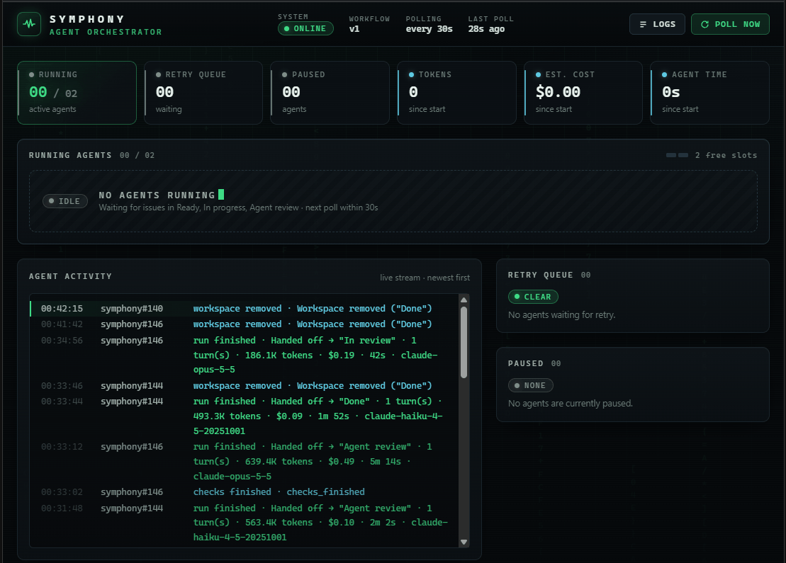

# Symphony für Laravel × Claude Code



[English](README.md) | **Deutsch**

[](LICENSE)


Schieb ein GitHub-Issue nach **Ready**, und ein Team aus **Claude-Code**-Agenten analysiert, entwirft, setzt um, testet,
prüft und merged es – du verfolgst alles im Live-Dashboard.

## 📖 Über das Projekt

Symphony ist ein dauerhaft laufender Dienst, der ein GitHub Project Board in eine Arbeitswarteschlange für KI-Agenten
verwandelt. Jedes Issue bekommt einen eigenen Workspace und pro Board-Spalte eine Rolle: Ein Analyst arbeitet die
Anforderungen heraus, ein Architect entwirft größere Änderungen, ein Developer setzt sie um, ein Test Engineer und ein
nur lesender Reviewer prüfen das Ergebnis, und sobald alle Checks grün sind, merged Symphony den Pull Request nach
`develop`. Leitplanken (Entry-Checks, nur lesende Review-Rollen, Rundenlimits, Kostenbudgets und ein Merge-Gate) machen
den unbeaufsichtigten Betrieb sicher. **Laravel**-Projekte werden über **Laravel Boost** besonders gut unterstützt.

Symphony ist eine unabhängige Implementierung der
[Symphony Service Specification](https://github.com/openai/symphony/blob/main/SPEC.md) von OpenAI, mit Claude Code statt
Codex und GitHub Projects als Tracker; den Vergleich, alle Features und den Tech-Stack beschreibt
[docs/overview.md](docs/overview.md) (englisch).

### So funktioniert es

```
Ready → Design → In progress → Testing → Documentation → Agent review → Security review → In review → Done
Analyst  Architect  Developer   Test Engineer  Docs-Agent   Reviewer      Security Auditor   Merge-Gate
                                                                                    Blocked: ein Agent braucht dich
```

Stufen, die ein Issue nicht braucht, werden ohne Session übersprungen. Einstellungen und Prompts stehen in
`WORKFLOW.md` und `roles/`; Board, Repositories, Modell und Tokens in `.env`.

## ✨ Features

- **Multi-Agenten-Pipeline**, gesteuert über die Board-Spalten: Jede Stufe übergibt mit einem typisierten Ergebnis
  (`report_result`), Review-Schleifen sind begrenzt ([Architektur](docs/concepts/multi-agent.md), [Ergebnis-Verträge](docs/results.md))
- **Arbeitspakete:** Der Architect kann ein sehr großes Feature in Sub-Issues mit eigener Pipeline aufteilen
  ([Details](docs/configuration.md#work-packages-split), [Warum](docs/concepts/multi-agent.md#work-packages-instead-of-an-integration-engineer))
- **Checks und Merge-Gate:** Lint, Analyse und Tests vor jeder Übergabe; die CI des Repositorys vor dem Merge
  ([Merge-Gate](docs/adapters/github-project.md#merge-gate))
- **Modell und Effort pro Issue** per Label (`Model: opus`, `Effort: high`) ([Nutzung](docs/usage.md#choosing-the-model-per-issue))
- **Issue-Befehle** wie `/plan`, `/concept`, `/refactoring`, der `/auto-code`-Autopilot und `/release`, das aus fertigen Epics eine Version mit Tag und GitHub-Release macht ([Nutzung](docs/usage.md#release-per-issue-release))
- **Live-Dashboard** mit Team-Ansicht, Änderungs-Feed, Statistik und JSON-API ([Dashboard](docs/usage.md#dashboard-and-api))
- **Wissens-Vault (Brain)**, den die Agenten teilen und du prüfst, auch in Obsidian ([Brain](docs/brain.md))
- **Laravel Boost** und eine Datenbank pro Workspace für Laravel-Apps ([Laravel](docs/laravel-repositories.md))
- **Docker-Image** hinter Traefik mit optionalen CI-Sidecars, Obsidian und Watchdog ([Docker](docs/docker.md))
- **Interaktiver Installer** für Ubuntu und WSL2 ([install.md](docs/install.md))

## 🚀 Erste Schritte

Du brauchst Ubuntu (22.04 oder neuer, auch WSL2), ein GitHub Project Board und ein Claude-Abo oder einen API-Key. Alles
andere prüft und installiert der Installer.

### Schnellstart mit dem Installer

```bash
git clone git@github.com:cooolinho/symphony.git && cd symphony
./install.sh
```

Der Installer bietet ein Menü und ein geführtes Setup für drei Betriebsarten: **nativ** (`npm start`), **Docker lokal**
und **Docker-Server hinter Traefik**. Er listet, welche Requirements vorhanden sind und welche fehlen, installiert die
ausgewählten (sudo-Passwort nur einmal), wartet auf deinen GitHub-Token und den Claude-OAuth-Token, richtet den
SSH-Schlüssel ein, schreibt eine schlanke `.env`, ergänzt fehlende Board-Spalten und Labels und startet Symphonys Dry
Run.

```bash
./install.sh --dry-run   # Simulation: fragt alles ab, ändert nichts
./install.sh --check     # nur die Requirements-Tabelle
./install.sh --help      # alle Optionen
```

Details: [docs/install.md](docs/install.md).

### Manuelles Setup

```bash
npm install
cp .env.example .env && chmod 600 .env   # Board, Repository, Token, Modell
npm run repo-init                        # Labels und fehlende Board-Spalten
npm run dry-run                          # Setup prüfen, ohne Agenten zu starten
npm start
```

Schritt für Schritt: [docs/getting-started.md](docs/getting-started.md) (nativ) und [docs/docker.md](docs/docker.md)
(Docker). Alle Variablen: [docs/environment.md](docs/environment.md).

## 📋 Nutzung

Schieb ein Issue nach `Ready`. Der Analyst schärft es (oder fragt dich in `Blocked`), danach läuft die Pipeline von
allein. Das Dashboard (`SYMPHONY_PORT`, z. B. <http://127.0.0.1:4000/>) zeigt, wer woran arbeitet und warum ein Issue
wartet. Kommentiere im Issue, um einen Agenten zu lenken, und wähle Modell und Effort per Label:

| Label | Wirkung |
|---|---|
| `Model: fable` / `opus` / `sonnet` / `haiku` | Claude-Modell des Developers (jede volle Modell-ID geht auch) |
| `Effort: low` … `Effort: max` | Denkaufwand |

Ohne Label nutzt der Developer `CLAUDE_MODEL` / `CLAUDE_EFFORT` aus `.env`. Alles Weitere, von Abhängigkeiten bis zu
Kosten und Fehlersuche: [docs/usage.md](docs/usage.md).

## 📁 Projektstruktur

```
symphony/
├── install.sh              # interaktiver Installer für Ubuntu/WSL2 (Bibliotheken in scripts/install/lib/)
├── WORKFLOW.md             # Einstellungen, Rollen, Checks und der gemeinsame Prompt (live neu geladen)
├── roles/                  # ein Prompt pro Rolle
├── checks/, hooks/         # Entry-Checks und CI-Gate; Workspace-Hooks (eigene .env und Datenbank)
├── .claude/                # Werkzeugkasten für alle Sessions: Skills, Agents, Commands
├── .env.example            # minimale Vorlage für .env (alle Variablen: docs/environment.md)
├── Dockerfile              # Image mit Node, PHP, Composer, pnpm, yarn, git, gitleaks und headless Chromium
├── docker-compose*.yml     # Betrieb hinter Traefik; lokaler Testlauf ohne Traefik (docker-compose.local.yml)
├── repo-init.ts            # Labels, Board-Spalten, Laravel-Boost-Issue
├── src/                    # Orchestrator, Tracker, Agenten, Workspaces, Brain, Dashboard
├── test/                   # Tests mit node:test
└── docs/                   # Dokumentation (Einstieg: docs/index.md)
```

## 📚 Dokumentation

Die Dokumentation ist auf Englisch.

| Dokument | Inhalt |
|---|---|
| [docs/install.md](docs/install.md) | Der Installer: Betriebsarten, Menü, Schritte, was er installiert, Optionen |
| [docs/environment.md](docs/environment.md) | Jede Umgebungsvariable mit ihrem Default |
| [docs/getting-started.md](docs/getting-started.md) | Setup von Hand: Board, Token, `.env`, Dry Run, Start |
| [docs/docker.md](docs/docker.md) | Docker hinter Traefik: Setup, HTTPS, CI-Sidecars, Obsidian, Backup, Fehler |
| [docs/usage.md](docs/usage.md) | Betrieb, Dashboard und API, Befehle, Logs und Kosten, Fehlersuche |
| [docs/overview.md](docs/overview.md) | Spezifikation, Funktionsweise, alle Features, Modelle pro Issue, Tech-Stack |
| [docs/configuration.md](docs/configuration.md) | Jede Option von `WORKFLOW.md`, Hooks und Prompt-Variablen |
| [docs/adapters/github-project.md](docs/adapters/github-project.md) | GitHub-Projects-Adapter, Agent-Tools, Merge-Gate |
| [docs/agent-claude.md](docs/agent-claude.md) | Claude-Code-Sessions, Berechtigungen, Skills, Plugins, Kosten |
| [docs/brain.md](docs/brain.md), [docs/watchdog.md](docs/watchdog.md) | Wissens-Vault; Blocked-Watchdog |
| [docs/results.md](docs/results.md), [docs/concepts/multi-agent.md](docs/concepts/multi-agent.md) | Ergebnis-Verträge; die Multi-Agenten-Architektur |
| [docs/laravel-repositories.md](docs/laravel-repositories.md), [docs/laravel-subagents.md](docs/laravel-subagents.md) | Laravel-Konventionen und Subagents |
| [docs/development.md](docs/development.md), [docs/gitflow.md](docs/gitflow.md), [docs/e2e.md](docs/e2e.md) | Arbeit an Symphony: Tests, CI, Git-Flow, End-to-End-Tests |
| [docs/conformance.md](docs/conformance.md) | Abweichungen von der Spezifikation |
| [CONTRIBUTING.md](CONTRIBUTING.md), [SECURITY.md](SECURITY.md) | Mitwirken; Sicherheitslücken vertraulich melden |

Der vollständige Index: [docs/index.md](docs/index.md).

## 🔗 Referenzen

- [Symphony Service Specification](https://github.com/openai/symphony/blob/main/SPEC.md) und die
  [Referenzimplementierung](https://github.com/openai/symphony) (OpenAI, Apache-2.0)
- [Claude Agent SDK](https://code.claude.com/docs/en/agent-sdk),
  [Claude-Code-Einstellungen und Sandbox](https://code.claude.com/docs/en/settings#sandbox-settings),
  [Plugins](https://code.claude.com/docs/en/plugins) und [Skills](https://code.claude.com/docs/en/skills)
- [Laravel Boost](https://laravel.com/docs/boost) und [Agent Skills](https://agentskills.io/what-are-skills)
- [GitHub Projects](https://docs.github.com/en/issues/planning-and-tracking-with-projects) und
  [die Projects-API](https://docs.github.com/en/issues/planning-and-tracking-with-projects/automating-your-project/using-the-api-to-manage-projects)
- [Obsidian](https://obsidian.md) und das [Obsidian-Image von linuxserver.io](https://docs.linuxserver.io/images/docker-obsidian/)
- [LiquidJS](https://liquidjs.com/), die Template-Sprache des Prompts

## 📄 Lizenz

[MIT](LICENSE): forken, ändern, ausliefern. Die verwendeten Pakete haben eigene Lizenzen; das Claude Agent SDK
unterliegt den Nutzungsbedingungen von Anthropic.
