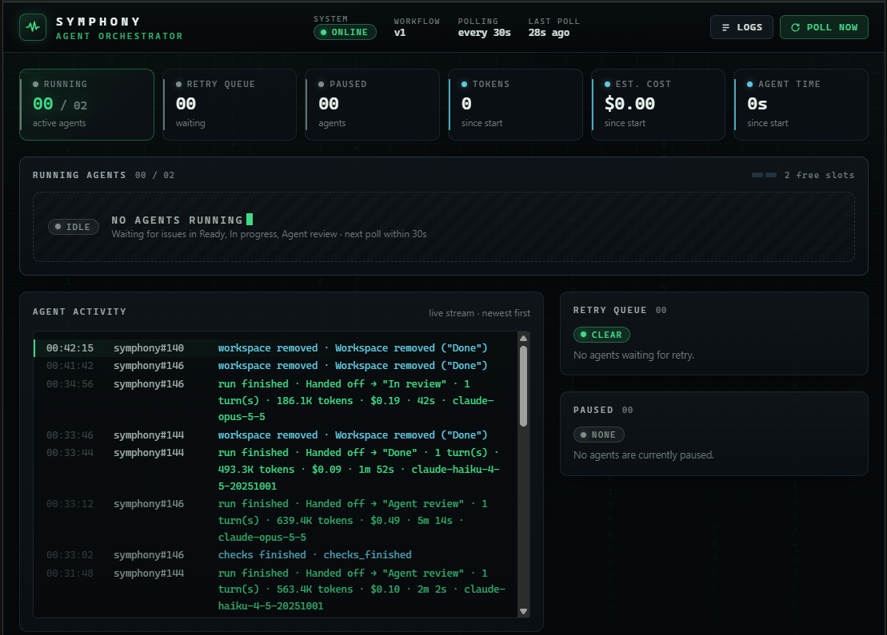

# Symphony for Laravel × Claude Code



**English** | [Deutsch](README.de.md)

[](LICENSE)


An autonomous coding pipeline: move a GitHub issue to **Ready**, and Symphony starts a **Claude Code** agent in an
isolated workspace that implements it, tests it, opens a pull request and hands it to a second, read-only agent for
review. You only look at the result.

This repository is my take on agent-driven software delivery: a long-running service that turns a project board into a
queue of work for AI agents, with guard rails (entry checks, a reviewer role, budgets, permission modes) that make it
safe to run unattended, and first-class support for **Laravel** projects through **Laravel Boost**.

## 🧭 Origin: the OpenAI Symphony specification

Symphony is an independent implementation of the
[**Symphony Service Specification**](https://github.com/openai/symphony/blob/main/SPEC.md) published by OpenAI:

> Symphony is a long-running automation service that continuously reads work from a configured issue tracker, creates
> an isolated workspace for each issue, and runs a coding agent session for that issue inside the workspace.

The spec defines the core: a `WORKFLOW.md` that holds the configuration and the prompt next to the code, one workspace
per issue, a polling loop with bounded concurrency, reconciliation, retries and an optional HTTP status API. It targets
the Codex app-server as its coding agent and leaves the tracker to adapters.

This implementation keeps that contract ([conformance notes](docs/conformance.md)) and adapts it:

| Spec | This implementation |
|---|---|
| Codex app-server | **Claude Code** through the [Claude Agent SDK](https://code.claude.com/docs/en/agent-sdk) ([mapping](docs/agent-claude.md)) |
| Pluggable tracker | **GitHub Projects (v2)** adapter: board columns drive the workflow ([profile](docs/adapters/github-project.md)) |
| One agent per issue | **Roles per column**: a developer implements, a read-only reviewer checks, auditor, autopilot, analyst and planner file sub-issues |
| Agent decides when it is done | **Entry checks** (lint, static analysis, tests) gate every handoff; a failing check keeps the card where it is |
| Generic repositories | **Tailored to Laravel**: Laravel Boost per workspace, per-workspace databases, a Laravel check script |

## 🐘 Built for Laravel projects

Symphony works with any repository, but it is tuned for Laravel applications:

- **Laravel Boost, automatically.** When a workspace contains a Laravel app that requires `laravel/boost`, Symphony
  installs the Composer dependencies, generates Boost's guidelines and skills for exactly the installed package
  versions, and attaches Boost's MCP server (documentation search, database schema, logs) to the session. Generated
  files never end up in the pull request. The dashboard shows whether and how the agent used Boost.
- **One environment per issue.** The `after_create` hook ([`hooks/laravel-env.sh`](hooks/laravel-env.sh)) gives every
  workspace its own `.env` and SQLite database (MySQL optional); [`hooks/laravel-db-drop.sh`](hooks/laravel-db-drop.sh)
  cleans up.
- **Laravel checks.** [`checks/laravel.sh`](checks/laravel.sh) runs Pint, static analysis and the test suite before an
  issue may move to `Agent review` or `In review`.
- **Laravel-aware subagents.** The shared toolbox in [`.claude/`](.claude/README.md) ships specialists such as
  `laravel-filament-developer`, `laravel-database-engineer`, `laravel-test-engineer` and a `laravel-code-reviewer`
  ([how they relate to the roles](docs/laravel-subagents.md)).
- **Repository conventions** for agent instructions, `.ai/`, Composer scripts and Boost are described in
  [docs/laravel-repositories.md](docs/laravel-repositories.md).

## 🤖 Claude models and effort, chosen per issue by label

The most visible control is on the issue itself: **labels pick the Claude model and the thinking effort** for the
agent that works on it.

| Label | Effect |
|---|---|
| `Model: fable` | Claude Fable for complex, high-risk work (data model, permissions, migrations, major upgrades) |
| `Model: opus` | Claude Opus for hard, open-ended work (architecture, tricky bugs, larger features) |
| `Model: sonnet` | Claude Sonnet for everyday implementation work |
| `Model: haiku` | Claude Haiku for small, well-defined changes (docs, copy, config) |
| `Model: claude-opus-5-5` | Any full model id works as well |
| `Effort: low` … `Effort: max` | Thinking effort: `low`, `medium`, `high`, `xhigh`, `max` |

- Without a label, the role's default applies (for example `opus` for the reviewer), then `CLAUDE_MODEL` /
  `CLAUDE_EFFORT` from `.env`.
- `npm run repo-init` creates the four model labels and the five effort labels (colored from light to dark) in your
  repositories.
- With `/auto-code … issue-models=auto`, the autopilot agent labels each sub-issue it creates with a model that fits the
  task, so cheap models handle simple tasks and strong models get the hard ones.
- Every run is logged per repository with model, tokens, estimated cost (from [`model-costs.yml`](model-costs.yml))
  and agent time, so the trade-off between model, effort and cost stays measurable.

Details: [choosing the model](docs/usage.md#choosing-the-model-per-issue) and
[the effort](docs/usage.md#choosing-the-effort-per-issue) per issue.

## 🧰 Tech stack

| | Technology | Used for |
|---|---|---|
|  | **Claude Code** + [Claude Agent SDK](https://code.claude.com/docs/en/agent-sdk) | Coding agents: sessions, turns, permission modes, plugins, skills, subagents |
|  | **Claude Fable / Opus / Sonnet / Haiku** | Models picked per issue by label, with per-issue effort |
|  | **Node.js 26** | Runtime; runs TypeScript directly, tests with `node:test` |
|  | **TypeScript** | The whole orchestrator, type-checked with `tsc` |
|  | **GitHub Projects v2, GraphQL & REST API** | Tracker: board columns, issues, sub-issues, labels, pull requests |
|  | **GitHub Actions** | CI (`npm run check`, Docker build) and auto-merge of agent pull requests |
|  | **Laravel + Laravel Boost** | Target projects; Boost guidelines, skills and MCP server per workspace |
|  | **PHP + Composer** | Preparing Laravel workspaces and running their checks |
|  | **Model Context Protocol** | In-process tracker tools for the agent; Laravel Boost MCP server |
|  | **Docker + Docker Compose** | Server deployment |
|  | **Traefik** | Reverse proxy with HTTPS for the dashboard |
|  | **Zod**, **LiquidJS**, **YAML** | Config validation, prompt templates, front matter |

## ⚙️ How it works

```
Backlog ─▶ Ready ─▶ In progress ─[Checks]─▶ Agent review ─[Checks]─▶ In review ─▶ Done
   │         │            │            ▲          │                     │          │
ignored   developer   developer        └─ changes reviewer           waits for   workspace
          starts      works               needed  checks (read-      you         deleted
                                                  only)
                 Blocked: an agent needs you (broken checks, open questions)
```

Symphony polls a **GitHub Project board** at a fixed interval and hands issues in active columns to **Claude Code**.
For each issue it creates a folder, clones the repository and lets the agent work: create a branch, implement, test,
push, open a pull request and comment on the issue. Automatic checks and a second, read-only agent (the reviewer)
then check the work. Only then does the card land in **In review**, where you review, merge and move it to **Done**.

What the agent does is defined in **`WORKFLOW.md`** (prompt and settings). Board, repositories, default model and token
live in **`.env`**.

## ✨ Features

- **Board-driven:** the columns of your GitHub Project board drive the flow. Ordered by priority and age, with bounded
  concurrency (overall and per column); open blockers are respected.
- **Isolated workspaces:** one clone per issue under `~/symphony-workspaces`, reused on retries and deleted once the
  issue is *Done*.
- **Developer and reviewer:** roles per column. Before `Agent review` and `In review`, checks run (lint, static
  analysis, tests); if they fail, the card stays and the agent fixes the problem.
- **Test engineer (optional):** an independent agent in the `Testing` column writes tests for the acceptance criteria and
  may only change test files; failed tests go back to the developer with the failed cases, and after
  `pipeline.max_test_rounds` failed rounds the issue waits for you
  ([details](docs/configuration.md#the-test-engineer)).
- **Issue commands:** a description that starts with `/refactoring` loads a centrally maintained audit skill that
  measures a baseline, finds bugs and refactoring candidates and files sub-issues; `/refactor-safely` implements them
  behavior-neutrally with tests as a safety net ([details](docs/usage.md#commands-in-the-issue-refactoring)).
- **Autopilot (`/auto-code`):** an epic with `/auto-code docs/index.md` lets Symphony evolve a project continuously.
  An autopilot agent derives waves of features, design, quality and maintenance tasks from the project description;
  they start right away and are merged into `develop` after review and checks. Every few waves it stops with a report
  and a release pull request to `main` ([details](docs/usage.md#autopilot-auto-code)).
- **Concept and list to backlog:** `/concept docs/index.md` breaks a concept down into epics and sub-issues
  ([details](docs/usage.md#concept-to-backlog-concept)); `/plan docs/todo.md`, or `/plan` with a list below it in the
  issue, turns every list item into one sub-issue with a detailed implementation plan, dependencies and effort and model
  labels, in the backlog ([details](docs/usage.md#list-to-backlog-plan)).
- **Tracker tools for the agent:** set the status, comment, open a pull request and (for the planning roles only)
  create sub-issues. The GitHub token stays in the Symphony process; the agent never sees it.
- **Robust:** retries with exponential backoff, stall detection; an agent is stopped when its issue changes on the board.
- **Session-limit handling:** when the Claude subscription hits its limit, Symphony retries a few times and then waits
  for the reset. A limit of one model (e.g. Fable) puts only that model on hold: its issues wait, the other models
  keep running, and no issue moves to another model ([details](docs/usage.md#session-limit)).
- **Live configuration:** `WORKFLOW.md` reloads without a restart; one instance can serve several repositories.
- **Observable:** dashboard with JSON API and a per-agent execution trace (prompts, model calls, tool calls, phases,
  tokens and cost), structured logs, one transcript per session, `--dry-run` to check the setup.
- **Logs and cost per repository:** a running log of every run with tokens, model, effort, estimated cost and agent
  time, with statistics in the dashboard; the details of finished runs stay available in the agent detail view.

## 🚀 Getting started

You need Node.js ≥ 26, git with SSH access to GitHub, a logged-in Claude Code and a GitHub token with the `repo` and
`project` scopes.

```bash
npm install
cp .env.example .env    # board number, repository, model and token
npm run dry-run         # check the setup without starting agents
npm start               # start Symphony
```

In between, create a GitHub Project board with the columns `Backlog`, `Ready`, `In progress`, `Testing`,
`Agent review`, `Blocked`, `In review` and `Done`. The step-by-step guide is [docs/getting-started.md](docs/getting-started.md);
running it with Docker behind Traefik is described in [docs/docker.md](docs/docker.md), a local test run of the same
image without Traefik (`docker-compose.local.yml`) in
[its own section](docs/docker.md#local-test-setup-without-traefik).

## 📋 Usage

Move an issue to `Ready`. A developer agent implements it and opens a pull request. After the checks pass, a read-only
reviewer agent reviews the work, then the card moves to `In review`. You merge the pull request and move the card to
`Done`. Labels like `Model: sonnet` and `Effort: high` choose model and effort per issue; the dashboard
(`SYMPHONY_PORT`) shows what runs, what starts next and why each issue waits, plus logs and cost.

Everything else is in [docs/usage.md](docs/usage.md): the life of an issue, intervening while it runs, dependencies,
model choice, `repo-init`, dashboard and API, logs and cost, several repositories, configuration, security, Laravel
Boost and troubleshooting.

## 📁 Project structure

```
symphony/
├── WORKFLOW.md                 # roles, checks, prompt and settings (reloaded live)
├── hooks/laravel-env.sh        # after_create: own .env and SQLite database per Laravel app (optional MySQL)
├── hooks/laravel-db-drop.sh    # before_remove: drops the workspace's MySQL databases
├── checks/laravel.sh           # entry check before Agent review and In review (lint, analysis, tests)
├── .claude/                    # toolbox for all sessions, loaded as plugin "symphony" (skills, agents, commands, hooks)
├── .github/workflows/          # CI (npm run check) and auto-merge of agent pull requests
├── model-costs.yml             # model prices for the cost estimate (reloaded live)
├── Dockerfile                  # image with Node, PHP, Composer, git and SSH; runs as user symphony
├── docker-compose.yml          # deployment behind Traefik: labels, volumes, secret for the SSH key
├── docker-compose.local.yml    # local test run of the same image without Traefik, dashboard on 127.0.0.1
├── docker/                     # entrypoint.sh (checks variables, SSH key, git identity) and ssh_known_hosts
├── .env.example                # template for .env (board, repository, model, token, limits)
├── repo-init.ts                # interactive repository setup (standard labels, Laravel Boost issue)
├── scripts/e2e/                # end-to-end test of the orchestration on a real board (npm run e2e)
├── scripts/laravel-smoke/      # integration test against a real Laravel 13 / Filament 5 app (npm run test:laravel)
├── scripts/push-history.sh     # copies the local history to a Symphony container on a server (docs/docker.md)
├── src/
│   ├── cli.ts                  # entry point: options, .env, start
│   ├── service.ts              # startup, shutdown, dry run
│   ├── workflow/               # load WORKFLOW.md, config, templates, live reload, validation
│   ├── tracker/                # tracker interface and GitHub Projects adapter with agent tools and auto-merge
│   ├── workspace/              # per-issue workspaces and hooks
│   ├── agent/                  # Claude Code sessions via the Claude Agent SDK, model and effort per label
│   ├── laravel/                # detect Laravel apps, prepare Laravel Boost per workspace
│   ├── orchestrator/           # polling, dispatch, reconciliation, retries
│   ├── history/                # per-repository log and statistics
│   ├── costs/                  # read model-costs.yml, compute cost
│   ├── http/                   # dashboard, agent detail view, logs page and JSON API
│   ├── repo-init/              # repo-init: picker, GitHub REST client, standard labels, Boost issue
│   └── util/                   # helpers (.env, paths, errors, …)
├── test/                       # tests with node:test
└── docs/                       # documentation (start at docs/index.md)
```

## 📚 Documentation

Start at [docs/index.md](docs/index.md).

- [docs/getting-started.md](docs/getting-started.md): step-by-step setup
- [docs/docker.md](docs/docker.md): running with Docker behind Traefik: setup, updates, backup, troubleshooting, security
- [docs/usage.md](docs/usage.md): operation, configuration and troubleshooting
- [docs/configuration.md](docs/configuration.md): every `WORKFLOW.md` option, `$VARIABLE` references, hooks and prompt variables
- [docs/adapters/github-project.md](docs/adapters/github-project.md): the GitHub Projects adapter: settings, normalization, agent tools, errors
- [docs/agent-claude.md](docs/agent-claude.md): Claude Code sessions, permissions, skills and plugins, Laravel Boost, timeouts, cost accounting
- [docs/conformance.md](docs/conformance.md): differences from the specification and implementation-defined behavior
- [docs/laravel-repositories.md](docs/laravel-repositories.md): conventions for Laravel repositories
- [docs/e2e.md](docs/e2e.md): end-to-end test of the orchestration and the Laravel integration test

## 🛠️ Development

```bash
npm test             # tests
npm run typecheck    # TypeScript check
npm run check        # both
npm run e2e          # end-to-end test on a test board (creates real issues)
npm run test:laravel # Laravel integration against a real app (needs PHP 8.3+, Composer, network)
```

CI ([.github/workflows/ci.yml](.github/workflows/ci.yml)) runs `npm run check` on Node 26 and a Docker build with a
start test of the image for every pull request and every push to `main`. When it passes for a pull request from the
Symphony agents (branch `symphony/*`), [.github/workflows/automerge.yml](.github/workflows/automerge.yml) squash-merges
it, closes the issues it names with `Closes #…` and deletes the branch. Symphony then starts the issues that depend on
them. The auto-merge always runs in the version from `main`, so a pull request cannot change the rules for its own merge.

A pull request stays open for you when

- it comes from a fork, even from a branch `symphony/*` there (the workflow only merges branches of this repository),
- it, or an issue it closes, has the label `manual-merge`,
- it closes no issue,
- it changes `.github/`, `package.json` or `package-lock.json` (CI, scripts, dependencies), or more than 100 files,
- CI fails or GitHub rejects the merge, for example because of conflicts with `main`.

## 🔗 References

- [Symphony Service Specification](https://github.com/openai/symphony/blob/main/SPEC.md) and the
  [reference implementation](https://github.com/openai/symphony) (OpenAI, Apache-2.0)
- [Claude Agent SDK](https://code.claude.com/docs/en/agent-sdk),
  [Claude Code settings and sandbox](https://code.claude.com/docs/en/settings#sandbox-settings),
  [plugins](https://code.claude.com/docs/en/plugins) and [skills](https://code.claude.com/docs/en/skills)
- [Laravel Boost](https://laravel.com/docs/boost) and [Agent Skills](https://agentskills.io/what-are-skills)
- [GitHub Projects](https://docs.github.com/en/issues/planning-and-tracking-with-projects) and
  [the Projects API](https://docs.github.com/en/issues/planning-and-tracking-with-projects/automating-your-project/using-the-api-to-manage-projects)
- [LiquidJS](https://liquidjs.com/), the template language of the prompt

## 🤝 Contributing

See [CONTRIBUTING.md](CONTRIBUTING.md). Report vulnerabilities privately, see [SECURITY.md](SECURITY.md).

## 📄 License

[MIT](LICENSE): fork it, change it, ship it. The packages used have their own licenses; the Claude Agent SDK is
subject to Anthropic's terms of service.
