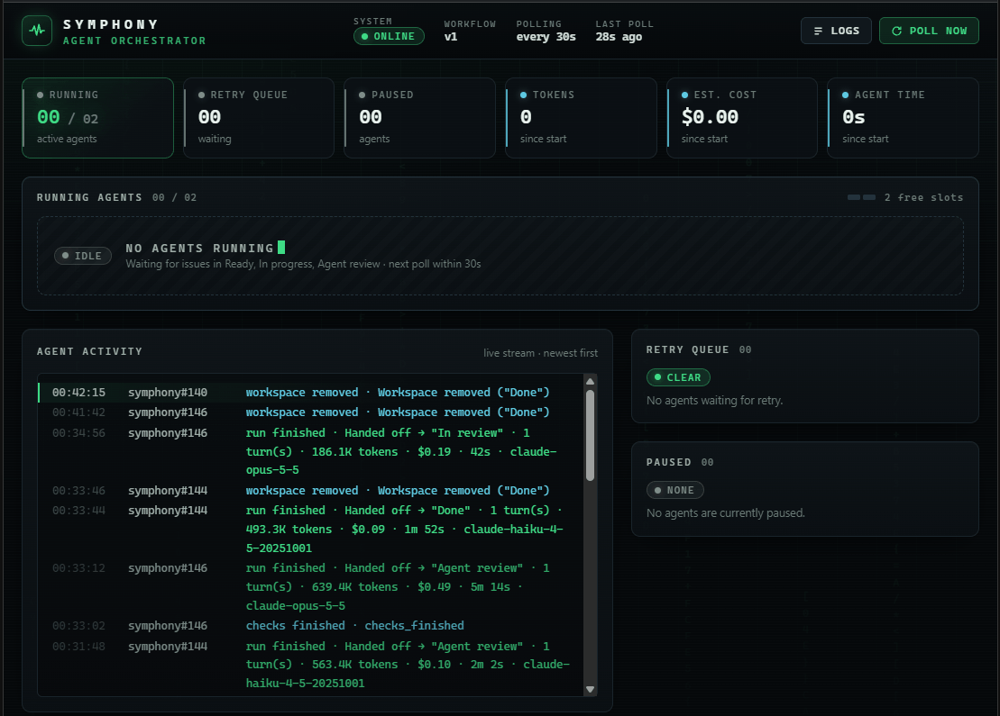

# Symphony for Laravel × Claude Code



**English** | [Deutsch](README.de.md)

[](LICENSE)


Move a GitHub issue to **Ready**, and a team of **Claude Code** agents analyses, designs, implements, tests, reviews
and merges it, while you watch on a live dashboard.

## 📖 About

Symphony is a long-running service that turns a GitHub Project board into a queue of work for AI agents. Every issue
gets its own workspace and a role per board column: an analyst works out the requirements, an architect designs larger
changes, a developer implements them, a test engineer and a read-only reviewer check the result, and once every check
is green Symphony merges the pull request into `develop`. Guard rails (entry checks, read-only review roles, round
limits, cost budgets and a merge gate) make it safe to run unattended. **Laravel** projects get first-class support
through **Laravel Boost**.

It is an independent implementation of OpenAI's
[Symphony Service Specification](https://github.com/openai/symphony/blob/main/SPEC.md), with Claude Code instead of
Codex and GitHub Projects as the tracker; the comparison, all features and the tech stack are in
[docs/overview.md](docs/overview.md).

### How it works

```
Ready → Design → In progress → Testing → Documentation → Agent review → Security review → In review → Done
analyst  architect  developer   test engineer  docs agent   reviewer      security auditor   merge gate
                                                                                    Blocked: an agent needs you
```

Stages an issue does not need are skipped without a session. Settings and prompts live in `WORKFLOW.md` and
`roles/`; board, repositories, model and tokens in `.env`.

## ✨ Features

- **Multi-agent pipeline** driven by the board columns: every stage hands off with a typed result (`report_result`),
  review loops are bounded ([architecture](docs/concepts/multi-agent.md), [result contracts](docs/results.md))
- **Work packages:** the architect can split a very large feature into sub-issues with their own pipeline
  ([details](docs/configuration.md#work-packages-split), [why](docs/concepts/multi-agent.md#work-packages-instead-of-an-integration-engineer))
- **Checks and merge gate:** lint, analysis and tests before every handoff; the repository's CI before the merge
  ([merge gate](docs/adapters/github-project.md#merge-gate))
- **Model and effort per issue** by label (`Model: opus`, `Effort: high`) ([usage](docs/usage.md#choosing-the-model-per-issue))
- **Issue commands** such as `/plan`, `/concept`, `/refactoring`, the `/auto-code` autopilot and `/release`, which turns finished epics into a version, tag and GitHub release ([usage](docs/usage.md#release-per-issue-release))
- **Live dashboard** with team view, change feed, statistics and a JSON API ([dashboard](docs/usage.md#dashboard-and-api))
- **Knowledge vault (brain)** the agents share, reviewed by you, also in Obsidian ([brain](docs/brain.md))
- **Laravel Boost** and one database per workspace for Laravel apps ([Laravel](docs/laravel-repositories.md))
- **Docker image** behind Traefik with optional CI sidecars, Obsidian and a watchdog ([docker](docs/docker.md))
- **Interactive installer** for Ubuntu and WSL2 ([install.md](docs/install.md))

## 🚀 Getting Started

You need Ubuntu (22.04 or newer, also WSL2), a GitHub Project board and a Claude subscription or API key. The
installer checks and installs everything else.

### Quick start with the installer

```bash
git clone git@github.com:cooolinho/symphony.git && cd symphony
./install.sh
```

The installer (in German) offers a menu and a guided setup for three modes: **native** (`npm start`), **Docker
local** and **Docker server behind Traefik**. It lists which requirements are there and which are missing, installs the
ones you pick (sudo password once), waits for your GitHub token and Claude OAuth token, sets up the SSH key, writes a
lean `.env`, adds missing board columns and labels, and runs Symphony's dry run.

```bash
./install.sh --dry-run   # simulation: asks everything, changes nothing
./install.sh --check     # only the requirements table
./install.sh --help      # all options
```

Details: [docs/install.md](docs/install.md).

### Manual setup

```bash
npm install
cp .env.example .env && chmod 600 .env   # board, repository, token, model
npm run repo-init                        # labels and missing board columns
npm run dry-run                          # check the setup without starting agents
npm start
```

Step by step: [docs/getting-started.md](docs/getting-started.md) (native) and [docs/docker.md](docs/docker.md)
(Docker). Every variable: [docs/environment.md](docs/environment.md).

## 📋 Usage

Move an issue to `Ready`. The analyst refines it (or asks you in `Blocked`), and the pipeline runs on its own from
there. The dashboard (`SYMPHONY_PORT`, e.g. <http://127.0.0.1:4000/>) shows who works on what and why an issue waits.
Comment on the issue to steer an agent, and pick the model and effort by label:

| Label | Effect |
|---|---|
| `Model: fable` / `opus` / `sonnet` / `haiku` | Claude model of the developer (any full model id works too) |
| `Effort: low` … `Effort: max` | Thinking effort |

Without a label the developer uses `CLAUDE_MODEL` / `CLAUDE_EFFORT` from `.env`. Everything else, from dependencies to
cost and troubleshooting: [docs/usage.md](docs/usage.md).

## 📁 Project Structure

```
symphony/
├── install.sh              # interactive installer for Ubuntu/WSL2 (libraries in scripts/install/lib/)
├── WORKFLOW.md             # settings, roles, checks and the shared prompt (reloaded live)
├── roles/                  # one prompt per role
├── checks/, hooks/         # entry checks and CI gate; workspace hooks (own .env and database)
├── .claude/                # toolbox for all sessions: skills, agents, commands
├── .env.example            # minimal template for .env (all variables: docs/environment.md)
├── Dockerfile              # image with Node, PHP, Composer, pnpm, yarn, git, gitleaks and headless Chromium
├── docker-compose*.yml     # deployment behind Traefik; local test run without Traefik (docker-compose.local.yml)
├── repo-init.ts            # labels, board columns, Laravel Boost issue
├── src/                    # orchestrator, tracker, agents, workspaces, brain, dashboard
├── test/                   # tests with node:test
└── docs/                   # documentation (start at docs/index.md)
```

## 📚 Documentation

| Document | Content |
|---|---|
| [docs/install.md](docs/install.md) | The installer: modes, menu, steps, what it installs, options |
| [docs/environment.md](docs/environment.md) | Every environment variable with its default |
| [docs/getting-started.md](docs/getting-started.md) | Setup by hand: board, token, `.env`, dry run, start |
| [docs/docker.md](docs/docker.md) | Docker behind Traefik: setup, HTTPS, CI sidecars, Obsidian, backup, errors |
| [docs/usage.md](docs/usage.md) | Operation, dashboard and API, commands, logs and cost, troubleshooting |
| [docs/overview.md](docs/overview.md) | Specification, how it works, all features, models per issue, tech stack |
| [docs/configuration.md](docs/configuration.md) | Every `WORKFLOW.md` option, hooks and prompt variables |
| [docs/adapters/github-project.md](docs/adapters/github-project.md) | GitHub Projects adapter, agent tools, merge gate |
| [docs/agent-claude.md](docs/agent-claude.md) | Claude Code sessions, permissions, skills, plugins, cost accounting |
| [docs/brain.md](docs/brain.md), [docs/watchdog.md](docs/watchdog.md) | Knowledge vault; blocked watchdog |
| [docs/results.md](docs/results.md), [docs/concepts/multi-agent.md](docs/concepts/multi-agent.md) | Result contracts; the multi-agent architecture |
| [docs/laravel-repositories.md](docs/laravel-repositories.md), [docs/laravel-subagents.md](docs/laravel-subagents.md) | Laravel conventions and subagents |
| [docs/development.md](docs/development.md), [docs/gitflow.md](docs/gitflow.md), [docs/e2e.md](docs/e2e.md) | Working on Symphony: tests, CI, git flow, end-to-end tests |
| [docs/conformance.md](docs/conformance.md) | Differences from the specification |
| [CONTRIBUTING.md](CONTRIBUTING.md), [SECURITY.md](SECURITY.md) | Contributing; reporting vulnerabilities privately |

The full index: [docs/index.md](docs/index.md).

## 🔗 References

- [Symphony Service Specification](https://github.com/openai/symphony/blob/main/SPEC.md) and the
  [reference implementation](https://github.com/openai/symphony) (OpenAI, Apache-2.0)
- [Claude Agent SDK](https://code.claude.com/docs/en/agent-sdk),
  [Claude Code settings and sandbox](https://code.claude.com/docs/en/settings#sandbox-settings),
  [plugins](https://code.claude.com/docs/en/plugins) and [skills](https://code.claude.com/docs/en/skills)
- [Laravel Boost](https://laravel.com/docs/boost) and [Agent Skills](https://agentskills.io/what-are-skills)
- [GitHub Projects](https://docs.github.com/en/issues/planning-and-tracking-with-projects) and
  [the Projects API](https://docs.github.com/en/issues/planning-and-tracking-with-projects/automating-your-project/using-the-api-to-manage-projects)
- [Obsidian](https://obsidian.md) and the [linuxserver.io Obsidian image](https://docs.linuxserver.io/images/docker-obsidian/)
- [LiquidJS](https://liquidjs.com/), the template language of the prompt

## 📄 License

[MIT](LICENSE): fork it, change it, ship it. The packages used have their own licenses; the Claude Agent SDK is
subject to Anthropic's terms of service.
